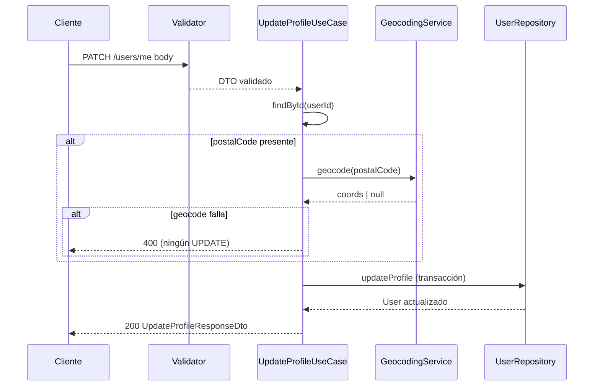

# Historia 6.4: PATCH /users/me — actualización de perfil

Status: done

<!-- Nota: Validación opcional con validate-create-story antes de dev-story. -->

## Historia

Como usuario autenticado,
quiero actualizar parcialmente mi perfil (nombre, avatar, teléfono, código postal o idioma preferido),
para mantener mis datos al día sin exponer campos de cuenta sensibles en la respuesta (FR39; architecture §8.5).

## Criterios de aceptación

1. **Dado** `PATCH /users/me` con al menos un campo opcional válido del contrato §8.5, **cuando** la operación es exitosa, **entonces** responde `200` con `{ id, firstName, lastName, avatarUrl, phone, postalCode, preferredLanguage }` **sin** `email` ni `emailVerified`.

2. **Dado** un body vacío `{}` o sin ningún campo permitido reconocido, **cuando** llega la petición, **entonces** responde `400 Bad Request`.

3. **Dado** el payload incluye `postalCode` que Nominatim/LRU no puede geocodificar, **cuando** se procesa la petición, **entonces** responde `400` y **ningún** campo del usuario se persiste (rollback / no iniciar UPDATE).

4. **Dado** el payload incluye `postalCode` y la geocodificación es exitosa, **cuando** termina la transacción de persistencia, **entonces** `postal_code` y `location` se actualizan y `jwt_version` se incrementa en **la misma transacción atómica**; el JWT usado en la petición queda invalidado para la siguiente llamada protegida.

5. **Dado** `avatarUrl: null` en el payload y el usuario tenía `avatar_url` no nulo, **cuando** el PATCH confirma, **entonces** `avatar_url` pasa a `NULL` en BD y la ruta de Storage del avatar anterior se encola en `storage_deletion_queue` (misma transacción que el UPDATE de usuario).

6. **Dado** `firstName` o `lastName` inválidos (< 2, > 50, caracteres no permitidos), **cuando** se valida el body, **entonces** responde `400` antes del use case.

7. **Regresión:** sin `Authorization` → `401`; campos prohibidos en body (`email`, `emailVerified`, `password`, `isActive`) → `400` vía validador estricto; `GET /users/me` y demás rutas `/users/*` existentes sin regresión.

## Alcance explícito (IN / OUT)

| IN (6.4) | OUT (6.5 / otras) |
|---|---|
| `PATCH /users/me` + validador Zod | Variables `firstName` en TPL emails (6.5) |
| `UpdateProfileRequestDto`, `UpdateProfileResponseDto` | Subida multipart de avatar (frontend; MVP envía URL ya subida) |
| `UpdateProfileUseCase` + `IUserRepository.updateProfile` | `email` / `emailVerified` editables |
| Re-geocodificación vía `IGeocodingService` | Regenerar cliente Angular |
| Transacción SQL: UPDATE + `jwt_version` + cola Storage | Desactivar cuenta (`is_active`) por API |
| OpenAPI: request/response PATCH + `npm run openapi:generate` | Ampliar `GET /users/me` (pertenece a 6.3) |
| Tests dedicados `users-me-patch.test.ts` (o bloque en `users-me.test.ts`) | |

**Prerrequisitos bloqueantes:**

| Historia | Qué debe existir antes de dev-story 6.4 |
|---|---|
| **6-1** | Migración `012`, entidad `User`, `mapRow`, columnas en `findById` |
| **6-2** (recomendado) | `personNameSchema` / `optionalPhoneSchema` en `validators/` — reutilizar en PATCH |
| **6-3** (recomendado) | DTOs de lectura alineados; para 6.4 definir **`UpdateProfileResponseDto`** como el subconjunto §8.5 de salida PATCH (puede vivir en `update-profile.dto.ts` aunque 6.3 no esté mergeada) |

**Orden sugerido en sprint:** 6-1 → 6-2 → 6-3 → **6.4** → 6.5.

## Tareas / Subtareas

- [x] **Task 0 — Verificar prerrequisitos** (bloqueante)
  - [x] `findById` devuelve `User` completo DLT-003
  - [x] Si `personNameSchema` no existe (6.2 pendiente), crearlo en esta historia **una sola vez** en `person-name.schema.ts` (no duplicar reglas)

- [x] **Task 1 — Validación HTTP (AC #2, #6, #7)**
  - [x] `src/interfaces/validators/update-profile.validator.ts`: body parcial con `.strict()`
  - [x] Campos opcionales: `firstName`, `lastName`, `avatarUrl` (`z.string().url().nullable()` o `z.string().nullable()` si URLs locales), `phone` (`max(20).nullable()`), `postalCode`, `preferredLanguage: z.literal('es')`
  - [x] `.refine()` — al menos una clave presente tras parse
  - [x] Importar `z` solo desde `src/zod.ts`

- [x] **Task 2 — DTOs (AC #1)**
  - [x] `src/application/dtos/update-profile.dto.ts`:
    - `UpdateProfileRequestDto` (campos opcionales del body)
    - `UpdateProfileResponseDto` — exactamente §8.5 PATCH response

- [x] **Task 3 — Repositorio `updateProfile` (AC #3, #4, #5)**
  - [x] Extender `IUserRepository` con `updateProfile(input: UpdateProfileInput): Promise<User>`
  - [x] Implementar en `PostgresUserRepository` con `BEGIN` / `COMMIT` / `ROLLBACK` (patrón `markUsedAndResetUserPassword` en `password-reset-token.repository.ts`)
  - [x] UPDATE dinámico solo de columnas presentes en input
  - [x] Si `postalCode` + coords: `postal_code = $n`, `location = ST_MakePoint(lon, lat)::geography`, `jwt_version = jwt_version + 1`
  - [x] Si `avatarUrl === null` y había URL previa: `INSERT INTO storage_deletion_queue (storage_path)` con path derivado del avatar anterior (ver §Storage path)

- [x] **Task 4 — `UpdateProfileUseCase` (AC #1–#5)**
  - [x] Cargar usuario por `userId`; si no existe → `UnauthorizedException` (mismo patrón que `GetPrivateProfileUseCase`)
  - [x] Si `postalCode` en DTO: llamar `geocodingService.geocode` **antes** de abrir transacción; `null` → `GeocodingException` (400 vía error handler)
  - [x] Delegar persistencia atómica al repo; mapear respuesta a `UpdateProfileResponseDto`
  - [x] No tocar `email`, `email_verified`, reputación ni totales

- [x] **Task 5 — HTTP (AC #1, #7)**
  - [x] `UserController.updateProfile`
  - [x] Ruta `PATCH /users/me` en `users.routes.ts` **junto al resto de `/me`** (antes de `GET /:id`)
  - [x] Wire: `GeocodingService`, `UpdateProfileUseCase`, validador

- [x] **Task 6 — OpenAPI**
  - [x] `updateProfileRequestSchema`, `updateProfileResponseSchema` en `user.schemas.ts`
  - [x] `registry.registerPath` PATCH `/users/me` en `register-paths.ts`
  - [x] `npm run openapi:generate`

- [x] **Task 7 — Tests (AC #1–#7)**
  - [x] Sin auth → 401
  - [x] `{}` → 400
  - [x] `firstName: 'A'` → 400
  - [x] PATCH solo `phone` → 200, mock `updateProfile` llamado con phone
  - [x] `postalCode` inválido → geocode null → 400, repo no llamado o sin commit
  - [x] `postalCode` válido → assert `jwt_version` increment en repo (mock o integración)
  - [x] `avatarUrl: null` con avatar previo → assert encolado `storage_deletion_queue`
  - [x] Respuesta no contiene `email`, `emailVerified`, `isActive`
  - [x] `npm test` + `npm run build`

---

## Notas para el Dev Agent

### Contrato HTTP exacto (architecture §8.5)

**PATCH /users/me — entrada (todos opcionales, al menos uno):**

```json
{
  "firstName": "María",
  "lastName": "García",
  "avatarUrl": "https://example.supabase.co/storage/v1/object/public/bucket/avatars/uuid/file.webp",
  "phone": "+34600111222",
  "postalCode": "28001",
  "preferredLanguage": "es"
}
```

**PATCH /users/me — respuesta 200:**

```json
{
  "id": "550e8400-e29b-41d4-a716-446655440000",
  "firstName": "María",
  "lastName": "García",
  "avatarUrl": "https://example.supabase.co/storage/v1/object/public/bucket/avatars/uuid/file.webp",
  "phone": "+34600111222",
  "postalCode": "28001",
  "preferredLanguage": "es"
}
```

**Errores:** 400 (validación Zod, CP no geocodificable), 401 (sin auth / usuario borrado).

**Campos prohibidos en entrada:** `email`, `emailVerified`, `password`, `isActive`, `location`, `jwtVersion`.

**Campos prohibidos en salida:** `email`, `emailVerified`, `reputationScore`, `totalReceived`, `totalDonated`, `consecutiveNoShows`, `createdAt`, `isActive`, `location`.

> La respuesta PATCH es **más pequeña** que `GET /users/me` (§8.5). No devolver el perfil privado completo en PATCH.

### Flujo de negocio (orden obligatorio)



1. Validar body (Zod).
2. Cargar usuario actual.
3. Si hay `postalCode`: geocodificar **fuera** de la transacción; fallo → `GeocodingException` → 400, **sin** UPDATE.
4. Transacción repo: aplicar solo campos enviados; si paso 3 OK → actualizar `location` + `jwt_version++`.
5. Si `avatarUrl === null` y `user.avatarUrl` anterior no nulo → encolar borrado Storage del path anterior.
6. Mapear respuesta PATCH (7 campos).

### Regla `jwt_version`

- Incrementar **solo** cuando el body incluye `postalCode` y la geocodificación fue exitosa.
- Misma transacción que `postal_code` + `location` (SEC-004, architecture §3.1).
- El cliente debe asumir re-login tras cambiar CP (documentado en delta DLT-003).
- Test sugerido: tras PATCH con CP, siguiente `GET /users/me` con el mismo Bearer → **401** (mock `jwtVersion` desincronizado).

### Storage — avatar `null` (AC #5)

- `avatar_url` en BD guarda URL pública (architecture §3.1).
- La cola `storage_deletion_queue` usa **`storage_path`** relativo (p. ej. `avatars/{userId}/file.webp`), no la URL completa.
- Crear helper pequeño (p. ej. `extractStoragePathFromPublicUrl(url: string): string | null`) en `infrastructure/storage/` reutilizando lógica inversa de `resolveStoragePublicUrl` (local vs Supabase).
- Si no se puede derivar path, **no** fallar el PATCH: log warning y limpiar `avatar_url` en BD (MVP: preferir encolar cuando path es derivable).
- Patrón transaccional: copiar `PostgresPasswordResetTokenRepository.markUsedAndResetUserPassword` (`client.query('BEGIN')` …).

```typescript
// Referencia — password-reset-token.repository.ts
await client.query(
  'UPDATE users SET password_hash = $1, jwt_version = jwt_version + 1 WHERE id = $2',
  [newPasswordHash, userId],
);
```

### Validador Zod (plantilla)

```typescript
import { z } from '../../zod';
import { personNameSchema, optionalPhoneSchema } from './person-name.schema';

export const updateProfileBodySchema = z
  .object({
    firstName: personNameSchema.optional(),
    lastName: personNameSchema.optional(),
    avatarUrl: z.string().url().nullable().optional(),
    phone: optionalPhoneSchema,
    postalCode: z.string().trim().min(1).max(20).optional(),
    preferredLanguage: z.literal('es').optional(),
  })
  .strict()
  .refine((data) => Object.keys(data).length > 0, {
    message: 'At least one field is required',
  });
```

Ajustar `postalCode` max length si el registro usa otra regla; alinear con `register.validator.ts`.

### DTOs objetivo

```typescript
// update-profile.dto.ts
export interface UpdateProfileRequestDto {
  firstName?: string;
  lastName?: string;
  avatarUrl?: string | null;
  phone?: string | null;
  postalCode?: string;
  preferredLanguage?: 'es';
}

export interface UpdateProfileResponseDto {
  id: string;
  firstName: string;
  lastName: string;
  avatarUrl: string | null;
  phone: string | null;
  postalCode: string;
  preferredLanguage: string;
}
```

### Repositorio — `UpdateProfileInput` (dominio)

```typescript
export interface UpdateProfileInput {
  userId: string;
  firstName?: string;
  lastName?: string;
  avatarUrl?: string | null;
  phone?: string | null;
  postalCode?: string;
  lat?: number;
  lon?: number;
  incrementJwtVersion: boolean;
  previousAvatarUrl: string | null;
}
```

El use case calcula `incrementJwtVersion: true` cuando geocodificó CP exitosamente.

### Estado actual del código (pre-6.4)

| Archivo | Estado |
|---|---|
| `users.routes.ts` | Solo GET; **no** existe `PATCH /users/me` |
| `user.controller.ts` | Sin `updateProfile` |
| `user.repository.ts` | Sin `updateProfile`; `create()` aún usa placeholders `'Usuario'/'Pendiente'` hasta 6.2 |
| `IUserRepository` | Sin método de actualización |
| `get-private-profile.use-case.ts` | Contrato v1.2 en código (6.3 lo amplía) |
| `register-user.use-case.ts` | Geocodifica antes de `create`; patrón a replicar |
| `person-name.schema.ts` | **No existe** aún (previsto en 6.2) |
| OpenAPI `register-paths.ts` | Sin path PATCH `/users/me` |

### Archivos a crear / tocar

| Acción | Ruta |
|---|---|
| NEW | `src/application/dtos/update-profile.dto.ts` |
| NEW | `src/application/use-cases/user/update-profile.use-case.ts` |
| NEW | `src/interfaces/validators/update-profile.validator.ts` |
| NEW | `tests/users-me-patch.test.ts` (preferido) |
| NEW (si falta 6.2) | `src/interfaces/validators/person-name.schema.ts` |
| NEW (opcional) | `src/infrastructure/storage/extract-storage-path.ts` |
| UPDATE | `src/domain/repositories/user.repository.ts` |
| UPDATE | `src/infrastructure/database/supabase/user.repository.ts` |
| UPDATE | `src/interfaces/http/controllers/user.controller.ts` |
| UPDATE | `src/interfaces/http/routes/users.routes.ts` |
| UPDATE | `src/openapi/schemas/user.schemas.ts` |
| UPDATE | `src/openapi/register-paths.ts` |

### Anti-patrones (no hacer en 6.4)

- No permitir editar `email` / `emailVerified`.
- No devolver entidad `User` ni `passwordHash` desde el controlador.
- No hacer UPDATE parcial si falla la geocodificación de `postalCode`.
- No incrementar `jwt_version` fuera de transacción con el UPDATE de CP.
- No borrar archivos Storage de forma síncrona en el request — solo cola.
- No implementar emails TPL (6.5).
- No usar `SELECT *` como fuente del DTO de respuesta.

### Cumplimiento de arquitectura

- **Clean Architecture:** validador → controlador → use case → repo; geocoding en application service.
- **NFR2:** `location` nunca en JSON.
- **NFR4:** DTOs explícitos; SQL con columnas nombradas.
- **NFR5:** no aplica 403 en esta ruta (solo propio usuario vía auth).

### Inteligencia de historias 6-1, 6-2 y 6-3

**6-1** (`6-1-migracion-sql-y-entidad-user-dlt-003.md`, status review):

- Columnas `first_name`, `avatar_url`, `phone`, `preferred_language` deben existir antes del PATCH.
- `create()` con placeholders: usuarios legacy tienen nombres "Usuario"/"Pendiente" hasta que PATCH o 6.2 registro real.

**6-2** (`6-2-registro-login-y-middleware-is-active.md`):

- Define `personNameSchema` — **reutilizar** en validador PATCH; no copiar regex.
- Middleware `isActive` ya rechaza cuenta inactiva antes del use case.

**6-3** (`6-3-dtos-perfil-privado-y-publico.md`):

- GET `/users/me` expone perfil completo; PATCH respuesta es subconjunto sin email.
- Sugiere `UpdateProfileResponseDto` como alias omitiendo campos de cuenta — implementar en 6.4 aunque 6.3 no esté en `main`.

### Historia siguiente (6.5)

Emails TPL con `{{firstName}}`; no bloquea 6.4.

### Verificación

```bash
npm run openapi:generate
npm run build
npm test -- users-me-patch
```

### Git reciente

- Épica 6 planificada en `7cc7200` (docs DLT-003).
- Entidad/migración 012 y mocks DLT-003 en tests; PATCH aún no implementado.

---

## Dev Agent Record

### Agent Model Used

Composer (dev-story runner)

### Debug Log References

(n/a)

### Completion Notes List

- Implementado `PATCH /users/me` con validador Zod `.strict()`, DTOs §8.5, `UpdateProfileUseCase` (geocode antes de transacción) y `PostgresUserRepository.updateProfile` con BEGIN/COMMIT/ROLLBACK.
- `jwt_version` se incrementa en la misma transacción que `postal_code` + `location` cuando el CP geocodifica OK.
- `avatarUrl: null` encola borrado en `storage_deletion_queue` vía `extractStoragePathFromPublicUrl`.
- OpenAPI actualizado (`updateProfileRequestSchema`, `updateProfileResponseSchema`, path PATCH).
- 11 tests nuevos en `tests/users-me-patch.test.ts`; suite completa 235 tests OK.

### File List

- src/application/dtos/update-profile.dto.ts (NEW)
- src/application/use-cases/user/update-profile.use-case.ts (NEW)
- src/interfaces/validators/update-profile.validator.ts (NEW)
- src/infrastructure/storage/extract-storage-path.ts (NEW)
- src/domain/repositories/user.repository.ts (UPDATE)
- src/infrastructure/database/supabase/user.repository.ts (UPDATE)
- src/interfaces/http/controllers/user.controller.ts (UPDATE)
- src/interfaces/http/routes/users.routes.ts (UPDATE)
- src/openapi/schemas/user.schemas.ts (UPDATE)
- src/openapi/register-paths.ts (UPDATE)
- openapi/openapi.json (UPDATE — generado)
- tests/users-me-patch.test.ts (NEW)

### Change Log

- 2026-05-24: Historia 6.4 — PATCH /users/me actualización de perfil (dev-story)

---

### Review Findings

- [x] [Review][Patch] `paramIdx++` doble en template literal ST_MakePoint — code smell; extraídos a variables `lonIdx`/`latIdx` [user.repository.ts] — **corregido**
- [x] [Review][Patch] `extractStoragePathFromPublicUrl` no eliminaba query params/fragments — storage path incorrecto si URL tiene `?q=` o `#` [extract-storage-path.ts] — **corregido**
- [x] [Review][Patch] Guard para `setClauses` vacío en `PostgresUserRepository.updateProfile` — SQL inválido en misuse del repo [user.repository.ts] — **corregido**
- [x] [Review][Patch] Tests AC #7 solo cubrían `email` como campo prohibido; faltan `password` e `isActive` [users-me-patch.test.ts] — **corregido**
- [x] [Review][Patch] Test JWT invalidation para AC #4 (jwtVersion stale → 401) no presente [users-me-patch.test.ts] — **corregido**
- [x] [Review][Defer] TOCTOU doble-encolado storage en PATCHes concurrentes — MVP accepted, pre-existing design — deferred
- [x] [Review][Dismiss] `postalCode max(10)` vs template `max(20)` — alineado con `register.validator.ts` (nota lo especificaba) — dismissed

## Referencias

- [Source: _bmad-output/initiative-backend/archive-v6/epics.md — Épica 6, Historia 6.4]
- [Source: docs/architecture.md — §3.1 users, §8.5 PATCH /users/me, §9 geocodificación]
- [Source: docs/delta-backend-DLT-003.md — PATCH /users/me]
- [Source: docs/prd.md — FR39]
- [Source: _bmad-output/initiative-backend/tickets/epic-ampliacion-del-modelo-de-usuario-dlt-003/tickets/story-migracion-sql-y-entidad-user-dlt-003-plan.md]
- [Source: _bmad-output/initiative-backend/tickets/epic-ampliacion-del-modelo-de-usuario-dlt-003/tickets/story-registro-login-y-middleware-is-active-plan.md]
- [Source: _bmad-output/initiative-backend/tickets/epic-ampliacion-del-modelo-de-usuario-dlt-003/tickets/story-dtos-perfil-privado-y-publico-plan.md]
- [Source: src/application/use-cases/user/register-user.use-case.ts]
- [Source: src/infrastructure/database/supabase/password-reset-token.repository.ts]
- [Source: src/infrastructure/storage/resolve-storage-public-url.ts]
- [Source: src/interfaces/http/routes/users.routes.ts]
- [Source: src/domain/repositories/user.repository.ts]

---

Ultimate context engine analysis completed — comprehensive developer guide created.
