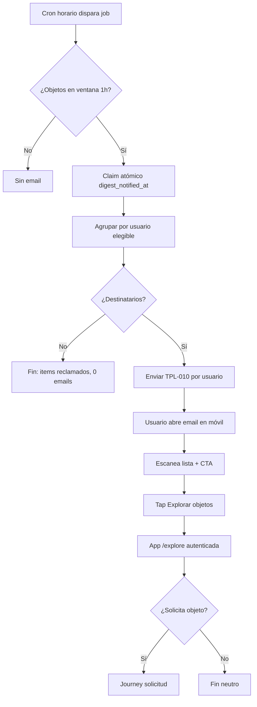

# UX Design Specification backend

**Author:** Emanuel  
**Date:** 2026-05-29

---

## Executive Summary

### Project Vision

Comunidad de regalo de objetos con asignación meritocrática: la UX debe transmitir confianza, claridad de siguientes pasos y respeto por el tiempo del usuario. Los emails transaccionales son un canal de producto (no solo técnico): confirman eventos, reducen fricción para volver a la app y refuerzan la marca visual definida en los prototipos Angular.

### Target Users

- **Donante:** publica, elige receptor, confirma entrega; emails de solicitudes, selección, degradación, cancelaciones.
- **Receptor activo:** solicita, compite en ranking, coordina entrega; emails de selección, sesión, digest de novedades cercanas (EVT-015).
- **Usuario en onboarding:** verificación de email (TPL-009) — copy y footer distintos al usuario ya activo.

Todos en MVP: español único, mobile-first en app; emails leídos sobre todo en clientes móviles (Gmail, etc.).

### Key Design Challenges

1. **Coherencia de voz** entre app (tuteo/voseo según pantalla) y emails (hoy inconsistente; TPL-010 mezcla «ti» y «vos»).
2. **Sistema de emails con shell compartido** pero cuerpos muy distintos (párrafo simple vs listado digest) sin romper accesibilidad ni tokens.
3. **Footer y confianza contextual** — mensajes de registro en emails de usuario verificado.
4. **Digest sin spam** — agrupación horaria, distancia aproximada, CTA único a explorar; sin exponer geolocalización exacta.
5. **Deuda transversal** — versión texto plano de emails no implementada (requisito en design doc).

### Design Opportunities

1. **Familia TPL-010** como patrón para futuros digests o resúmenes.
2. **Etiquetas de estado del objeto** en listados de email (alineado con feed y TPL-003).
3. **Footers diferenciados** por tipo de evento (onboarding / transaccional / marketing futuro).
4. **Copy de referencia centralizado** en `email-template-design.md` para TPL-009 y TPL-010 (hoy solo 009 tiene § dedicado).

## Core User Experience

### Defining Experience

**En la app:** el loop central es *descubrir un objeto cercano → solicitar → (como donante) elegir receptor → completar entrega*. El valor se siente cuando el intercambio avanza sin fricción ni sorpresas del sistema.

**En emails:** el loop paralelo es *enterarse a tiempo → entender qué pasó → volver a la app con un solo gesto*. Para **EVT-015 / TPL-010**, la acción crítica es: **«Ver qué hay nuevo cerca y decidir si solicito algo»** sin abrir la app por curiosidad cada hora.

La interacción que hay que clavar: **un CTA claro («Explorar objetos») después de un resumen escaneable en 10 segundos**.

### Platform Strategy

| Canal | Rol UX |
|--------|--------|
| **Web Angular (mobile-first)** | Explorar mapa/radio, publicar, solicitar, sesión de entrega |
| **Email HTML (600px, inline CSS)** | Notificación transaccional + digest; lectura en Gmail/Outlook móvil |
| **Cron externo** | Sin UI; el usuario solo percibe el email |

Constraints: sin ubicación exacta en email; tokens alineados a `colors_and_type.css`; un solo idioma (ES) en MVP.

### Effortless Interactions

- **Digest agrupado** — un mail/hora, no uno por objeto.
- **Lista escaneable** — título + distancia (~km) + thumb opcional; sin leer párrafos largos.
- **Un solo CTA primario** — a `/explore`, no deep links por ítem en v1.
- **Emails de evento** — asunto = escena; cuerpo = qué pasó + qué hacer ahora.
- **Marca reconocible** — mismo header/footer que TPL-002…009.

### Critical Success Moments

1. **Receptor abre TPL-010** y piensa: «Hay cosas interesantes cerca» → tap en Explorar.
2. **Donante recibe TPL-006** y entra a ver candidatos sin buscar la notificación en la app.
3. **Onboarding TPL-009** — verificación en un click; footer coherente con registro.
4. **Fallo si:** copy confuso (ti/vos), lista vacía con texto que promete objetos, footer de «creaste cuenta» en usuario activo.

### Experience Principles

1. **Claridad antes que cleverness** — copy directo, voseo consistente, un CTA por email.
2. **Respeto por la atención** — digests agrupados; sin datos sensibles en email.
3. **Continuidad app ↔ email** — mismos tokens, mismas etiquetas de estado que el feed.
4. **Confianza contextual** — footer y tono según momento del usuario (nuevo vs activo).
5. **Accesibilidad no negociable** — contraste AA, `alt` en imágenes, camino a plain text (backlog).

## Desired Emotional Response

### Primary Emotional Goals

- **Confianza comunitaria** — «esto es serio, no un chat de ventas raras».
- **Oportunidad tranquila** — cercanía sin urgencia falsa ni FOMO agresivo.
- **Control** — entiendo qué pasó y qué puedo hacer en un paso.
- **Respeto** — no me spamean; el digest agrupa y respeta mi bandeja.

### Emotional Journey Mapping

| Momento | Emoción deseada | Canal |
|---------|-----------------|--------|
| Registro / TPL-009 | Seguridad, claridad | Email onboarding |
| Primera solicitud / selección | Expectativa positiva, legitimidad | App + TPL-003/006 |
| **Digest TPL-010** | Curiosidad amable, «algo para mí cerca» | Email |
| Tras tap en Explorar | Empoderamiento (llego al feed listo) | App |
| Error / sesión expirada | Calma, sin culpa excesiva | TPL-004/005 |
| Retorno semanal | Familiaridad de marca (mismo shell) | Emails |

### Micro-Emotions

| Priorizar | Evitar |
|-----------|--------|
| Confianza > escepticismo | Desconfianza por copy genérico o footer incorrecto |
| Claridad > confusión | Mezcla ti/vos |
| Anticipación ligera > ansiedad | «¡URGENTE! 50 objetos!!!» |
| Pertenencia local > aislamiento | Distancia humana («~3 km») sin stalkeo |

### Design Implications

- **Confianza** → header de marca, copy sobrio, sin exagerar cantidades.
- **Oportunidad tranquila** → «en la última hora», lista ordenada por cercanía, un CTA.
- **Control** → asunto descriptivo; preheader honesto; CTA único.
- **Evitar ansiedad** → sin countdown falso; sin ubicación exacta.
- **Pertenencia** → voseo consistente («cerca tuyo», «Entrá»).

### Emotional Design Principles

1. **Calma con energía** — útil, no alarmista.
2. **Honestidad en el preview** — preheader = contenido real.
3. **Calidez sin infantilizar** — comunidad adulta de regalo.
4. **Coherencia emocional** — mismo tono en TPL-002…010.
5. **Recuperación digna** — errores con voz neutra y siguiente paso claro.

## UX Pattern Analysis & Inspiration

### Inspiring Products Analysis

| Referente | Qué hace bien | Relevancia para Regálalo |
|-----------|----------------|----------------------------|
| **Wallapop / marketplace local** | Proximidad, listados escaneables, confianza por distancia aproximada | Feed + digest TPL-010 (título + ~km) |
| **Airbnb (emails transaccionales)** | Un CTA claro, jerarquía visual, tono calmado | Shell TPL-010 + CTA «Explorar objetos» |
| **Linear / Stripe (notifications)** | Asunto = hecho; cuerpo mínimo; marca consistente | Familia TPL-002…009 |
| **Substack / digests de lectura** | Agrupación en un solo envío, lista legible en móvil | EVT-015 agrupado por hora |
| **Nextdoor (vecindario)** | Pertenencia local sin marketplace agresivo | Emoción «cerca tuyo», no venta |

**Propio:** prototipos `no-lo-vendo/docs/project/` — Playfair + eucalyptus ya replicados en emails.

### Transferable UX Patterns

**Email / digest**

- Lista con separadores y thumb opcional (patrón e-commerce/newsletter).
- Un CTA primario full-width bajo el contenido (patrón SaaS).
- Preheader que resume el valor real (patrón newsletters serios).

**App (continuidad)**

- Card de objeto en feed = misma info que fila en email (título, estado, distancia).
- Deep link post-CTA a explorar, no a ítem suelto en v1.

**Voz**

- Voseo rioplatense consistente (apps locales AR/UY).

### Anti-Patterns to Avoid

- **Un email por evento** cuando hay burst (objetos/hora) → spam.
- **Urgencia falsa** — «¡Última oportunidad!» en digest comunitario.
- **Footer de registro** en usuario activo → rompe confianza.
- **Lista vacía + copy que promete N objetos** → decepción inmediata.
- **Imágenes sin `alt`** — fallo de accesibilidad y clientes con imágenes bloqueadas.
- **Mezcla tuteo/voseo** en el mismo mensaje (TPL-010).

### Design Inspiration Strategy

| Estrategia | Acción |
|------------|--------|
| **Adoptar** | Shell 600px Épica 9; digest agrupado tipo newsletter; CTA único tipo Stripe/Airbnb |
| **Adaptar** | Lista con distancia (~km) en lugar de precio; thumbs pequeños 64px; sin precio ni negociación |
| **Evitar** | FOMO marketplace; footers genéricos; múltiples CTAs compitiendo |

## Design System Foundation

### 1.1 Design System Choice

**Enfoque híbrido «custom con tokens compartidos»** — no Material/Ant desde cero.

| Capa | Sistema | Fuente canónica |
|------|---------|-----------------|
| **App (Angular)** | Design system **custom** portado desde prototipos HTML | `no-lo-vendo/docs/project/` + `colors_and_type.css` |
| **Emails (Resend)** | **Custom table-based** con tokens espejo | `email-design-tokens.ts` + `renderEmailLayout()` (Épica 9) |

Los emails **no** usan el CSS de Angular: replican tokens de forma manual (sync documentado en `email-template-design.md` §2).

### Rationale for Selection

- Marca ya definida (eucalyptus `#3A7358`, Playfair + DM Sans) — no conviene un kit genérico.
- AGENTS.md exige **pixel-perfect** desde `docs/project/` — descarta «themeable MUI» como base visual.
- Emails requieren HTML inline 600px — sistema aparte pero **alineado por tokens**.
- MVP en marcha: velocidad = reutilizar shell TPL-xxx, no rediseñar component library.

### Implementation Approach

**App**

- Tokens CSS en `:root` del proyecto Angular.
- Componentes standalone alineados a wireframes/HTML de referencia.
- Sin inventar paleta fuera de `colors_and_type.css`.

**Emails**

- Toda plantilla → `renderEmailLayout()` + componentes (`email-button`, `email-paragraph`, etc.).
- Nuevos cuerpos ricos (TPL-010) = fragmentos HTML en la plantilla, no CSS externo.
- Registry `TPL-001…010` como catálogo único.

**Puente app ↔ email**

- Misma semántica de **estado del objeto** (`good` → «Buen estado») en feed y filas de digest.
- Misma URL base `APP_PUBLIC_URL` para CTAs.

### Customization Strategy

| Elemento | App | Email |
|----------|-----|-------|
| Tipografía | Google Fonts en app | Stacks web-safe en inline |
| Color primario | `--color-primary-500` | `tokens.primary` |
| Listado de objetos | Cards en feed | Tabla filas TPL-010 (64px thumb) |
| Footer legal | Páginas legales en app | Footer transaccional (pendiente: variantes por contexto) |

**Extensiones acordadas (foco emails):**

1. Componente compartido **`CONDITION_LABELS`** (app + TPL-003 + TPL-010).
2. **§5b** en `email-template-design.md` — copy de referencia TPL-010.
3. **Footer variants** — onboarding vs transaccional (backlog UX).

## 2. Core User Experience (detalle)

### 2.1 Defining Experience

**App (producto):** *«Encontrar algo gratis cerca que valga la pena pedir, y que el sistema me trate justo en el ranking.»*

**Email TPL-010 (canal):** *«Cada hora, un solo mensaje que me dice qué apareció cerca — sin spam — y me lleva a explorar en un tap.»*

Frase para contar el digest: **«Te avisa una vez por hora qué regalaron cerca tuyo.»**

### 2.2 User Mental Model

- Hoy: grupos de Facebook / Wallapop → ruido, muchos mensajes, desconfianza.
- Esperan: **proximidad + gratis + poco esfuerzo**.
- En email: «notificación útil» ≠ «marketing»; si parece spam, desconfianza.
- Confusión posible: footer de registro en usuario activo; contador que no coincide con la lista.

### 2.3 Success Criteria

| Criterio | Indicador |
|----------|-----------|
| Escaneo rápido | Entender valor en <10 s en móvil |
| Honestidad | Preheader y cuerpo coinciden con la lista |
| Acción clara | Un CTA, ≥44px, «Explorar objetos» |
| Confianza | Voseo uniforme; sin ubicación exacta |
| Continuidad | Llegar al feed explorar sin login extra |

### 2.4 Novel UX Patterns

- **Establecido:** digest newsletter, lista + CTA.
- **Establecido:** notificación transaccional con shell de marca.
- **Twist propio:** reputación en app; en email solo señales suaves (distancia, estado).
- **No novel:** no educar en gesto nuevo; sí en frecuencia horaria («como máximo uno por hora»).

### 2.5 Experience Mechanics (TPL-010)

| Fase | Diseño |
|------|--------|
| **Initiation** | Cron dispara EVT-015; usuario recibe email en bandeja |
| **Interaction** | Asunto → preheader → saludo → H1 → párrafo → lista (título, ~km, thumb opcional) |
| **Feedback** | Cantidad en texto = ítems visibles; distancia refuerza «cerca» |
| **Completion** | Tap CTA → `/explore`; explora y solicita si le interesa |
| **Error** | Sin envío si lista vacía (negocio); fallo Resend = usuario no ve email |

## Visual Design Foundation

### Color System

| Rol semántico | Token app | Token email | Uso TPL-010 |
|---------------|-----------|-------------|-------------|
| Primario / CTA | `--color-primary-500` `#3A7358` | `tokens.primary` | Botón «Explorar objetos» |
| Fondo página | `--color-neutral-50` `#F4F5F6` | `tokens.background` | Wrapper externo email |
| Superficie | `--color-neutral-0` | `tokens.surface` | Card 600px |
| Texto principal | `--fg-primary` `#14171A` | `tokens.textPrimary` | Títulos de ítems |
| Texto secundario | `--fg-secondary` `#606A76` | `tokens.textSecondary` | Párrafo intro |
| Texto muted | `--fg-muted` `#7C8692` | `tokens.textMuted` | «A ~3 km de vos» |
| Borde | `--color-neutral-200` | `tokens.border` | Separadores entre filas |

**Header email:** fondo primary-500, nombre de marca en blanco — igual que TPL-002…009.

### Typography System

| Nivel | Fuente | Email (inline) | Tamaño ref. |
|-------|--------|----------------|-------------|
| H1 / titular | Playfair Display | `'Playfair Display', Georgia, serif` | 24px |
| Cuerpo / UI | DM Sans | `'DM Sans', Arial, Helvetica, sans-serif` | 16px cuerpo, 15px ítems, 13px meta |
| Marca header | Playfair 700 | igual | 22px |

Tono: **cálido y claro**, comunidad local; no corporate frío.

### Spacing & Layout Foundation

**App:** grid y espaciado según prototipos HTML (base 8px implícito en componentes).

**Email (600px table):**

- Padding body: `32px 40px`
- Lista digest: `12px` vertical por fila; borde inferior `1px` border token
- Thumb: `64×64px`, `border-radius: 4px`, margen derecho `12px`
- CTA: altura ~44px, padding horizontal `32px` (patrón `email-button`)

Principio: **aireado pero escaneable** — más denso en la lista que en párrafos intro.

### Accessibility Considerations

- Contraste CTA blanco sobre `#3A7358` — WCAG AA (design doc §6).
- Un `<h1>` por email.
- **`alt` descriptivo** en thumbs (acción pendiente post-review UX).
- Enlaces con texto descriptivo («Explorar objetos»).
- Plain text: backlog global (Resend solo HTML hoy).

## Design Direction Decision

### Design Directions Explored

| ID | Nombre | Descripción | Pros | Contras |
|----|--------|-------------|------|---------|
| **A** | Actual (implementada) | Lista con thumb 64px + título + «~N km» | Visual, alineada al feed | `alt` vacío; ti/vos mezclado |
| **B** | Solo texto | Sin imágenes; título + estado + distancia | Ligero, accesible | Menos continuidad con feed |
| **C** | Rica recomendada | Thumb + título + etiqueta de estado + distancia; voseo unificado | Mejor decisión en bandeja | Más altura por fila |
| **D** | Compacta | Máx. 3 ítems + «y N más» | Email corto | Oculta inventario |

Mockups comparativos: `_bmad-output/initiative-backend/ux-design-specification/ux-design-directions-email.html`

### Chosen Direction

**Dirección C — «Rica recomendada»** (evolución de A con ajustes del review UX).

### Design Rationale

- Oportunidad tranquila + confianza; alineación con cards del feed.
- Evita anti-patrones: contador desincronizado, footer onboarding, spam.

### Implementation Approach

1. Copy voseo unificado en `tpl-010-nearby-items-digest.ts`.
2. `CONDITION_LABELS` compartido (TPL-003 / TPL-010).
3. `alt` descriptivo en thumbs.
4. §5b TPL-010 en `docs/email-template-design.md`.
5. Regenerar snapshots Vitest.

## User Journey Flows

### Journey: Digest de proximidad (TPL-010 / EVT-015)

**Actor:** Receptor verificado con `location`, activo, no donante del ítem.  
**Objetivo:** Enterarse de objetos nuevos a ≤50 km sin spam.  
**Éxito:** Abre email → explora en app → solicita (opcional).

**Puntos de contacto:** bandeja → `/explore` → card en feed → solicitud.  
**Fricciones a evitar:** ti/vos mezclado; footer onboarding; contador ≠ lista.

### Journey: Contraste — evento puntual (TPL-006)

Un objeto, un email, CTA al ítem. No usar patrón de lista digest.

### Journey: Onboarding (TPL-009)

Verificación de cuenta; footer «¿No creaste esta cuenta?» **solo** aquí.

### Optimizaciones acordadas

- Dirección visual **C** en filas del digest (estado + distancia + thumb con alt).
- Footer transaccional distinto del onboarding (backlog).
- Plain text espejo (backlog global).

## Component Strategy

### Available from Design System (email)

| Componente | Archivo | Uso |
|------------|---------|-----|
| Layout shell | `layout/email-layout.ts` | Todas las TPL |
| Párrafo | `components/email-paragraph.ts` | Intro digest |
| Botón CTA | `components/email-button.ts` | Explorar objetos |
| Heading | `components/email-heading.ts` | vía layout |
| Footer | `components/email-footer.ts` | Pie (pendiente variante) |
| Escape HTML | `escape-html.ts` | Títulos, URLs |

### Gap Analysis

| Necesidad | Journey | Estado |
|-----------|---------|--------|
| **DigestItemRow** | TPL-010 | Inline en tpl-010 — extraer a componente |
| **ConditionLabel** | Feed + TPL-003 + TPL-010 | Duplicado — centralizar |
| **EmailFooterTransactional** | TPL-002…010 | Gap — footer único hoy |
| **ItemCard** (app) | Feed explore | Prototipos HTML / Angular |

### DigestItemRow (custom)

**Purpose:** Fila del digest (objeto cercano).  
**Content:** thumb opcional, título, `estado · ~N km de vos`.  
**States:** con/sin imagen; fallback sin imagen.  
**Variants:** última fila sin borde inferior.  
**Accessibility:** `alt` = título; tabla `role="presentation"`.

### EmailFooterTransactional (backlog)

**Purpose:** Pie para usuarios activos.  
**Content:** «¿Necesitás ayuda?» + soporte + copyright.  
**Usage:** TPL-002…010; TPL-009 mantiene footer onboarding.

### Implementation Approach

1. `email-digest-item-row.ts` (title, conditionLabel, distanceKm, imageUrl?).
2. `email-condition-labels.ts` compartido con TPL-003.
3. `renderEmailLayout({ footerVariant })`.
4. Documentar en `email-template-design.md` §7.

## UX Consistency Patterns

### CTA y jerarquía (email)

**When to use:** Un CTA primario por email transaccional.  
**Visual:** `#3A7358`, texto blanco, ~44px alto, centrado.  
**Behavior:** Digest → «Explorar objetos» → `/explore`; eventos → CTA contextual.  
**Accessibility:** Texto descriptivo; no «click aquí».  
**Mobile:** Área táctil ≥44px.

### Feedback (email)

| Situación | Patrón |
|-----------|--------|
| Éxito | Copy positivo + CTA (TPL-003, 006) |
| Informativo | Digest TPL-010 sin urgencia |
| Error/expiración | Calma + siguiente paso (TPL-004/005) |
| Sin datos | No enviar email vacío (digest) |

### Copy y voz

Voseo rioplatense en TPL-002…010; TPL-009 onboarding puede mantener tono de registro.

### Listados (email)

Filas digest: thumb opcional + título + `estado · ~N km`; orden por distancia; contador = filas visibles.

### Navegación post-email

CTA lleva a ruta esperada autenticada; digest → `/explore`.

### Footer

Onboarding (TPL-009) vs transaccional (backlog) — no mezclar.

## Responsive Design & Accessibility

### Responsive Strategy

**App (Angular, mobile-first):** explore y cards según prototipos `no-lo-vendo/docs/project/`; breakpoints no inventados fuera del bundle.

| Viewport | Enfoque |
|----------|---------|
| Móvil 320–767px | Flujo principal |
| Tablet 768–1023px | Misma jerarquía, más aire |
| Desktop 1024px+ | Contenedor max-width |

**Email:** max-width 600px; tablas fluid 100%; diseño móvil primero; thumb 64px fijo.

### Accessibility Strategy

**Objetivo:** WCAG 2.1 AA (`email-template-design.md` §6, AGENTS.md).

| Área | Requisito | Estado TPL-010 |
|------|-----------|----------------|
| Contraste | AA texto y CTA | OK |
| Estructura | Un h1 por email | OK |
| Imágenes | alt significativo | Pendiente |
| Enlaces | Texto descriptivo | OK |
| Plain text | Espejo HTML | Backlog |

**Testing email:** Gmail web, Outlook web, móvil (design doc §6).

### Checklist implementación TPL-010 (dirección C)

- [ ] Voseo unificado (asunto, H1, cuerpo)
- [ ] alt = título en thumbs
- [ ] Etiqueta de estado en fila
- [ ] Contador = items.length
- [ ] §5b en email-template-design.md
- [ ] Snapshots Vitest

---

## Workflow Completion

**Estado:** UX design specification completa — 2026-05-29.  
**Alcance:** Producto (app + emails), foco emails transaccionales y TPL-010.  
**Assets:** `ux-design-directions-email.html` (direcciones A/B/C).  
**Próximo paso sugerido:** implementar checklist TPL-010 (dev-story o quick-dev) y §5b en `docs/email-template-design.md`.
