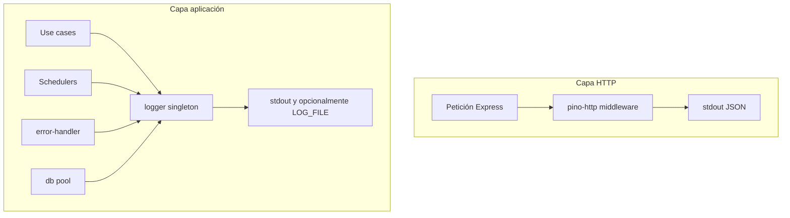

# Logging en el backend

El backend usa **[Pino](https://getpino.io/)** para logs estructurados en JSON y **[pino-http](https://github.com/pinojs/pino-http)** para registrar cada petición HTTP.

## Resumen rápido

| Aspecto | Comportamiento actual |
|--------|------------------------|
| Librería | `pino` + `pino-http` |
| Formato | Una línea JSON por evento (NDJSON) |
| Destino por defecto | **stdout** (consola del proceso Node) |
| Destino opcional | `LOG_FILE` — escribe también en fichero (multistream stdout + archivo) |
| Nivel configurable | `LOG_LEVEL` (variable de entorno, validado en `env.ts`) |
| Logger compartido | `src/infrastructure/logging/logger.ts` |
| Carpeta `logs/` | Ignorada por git; creada automáticamente si `LOG_FILE` apunta ahí |
| Tests | `LOG_LEVEL=silent` (Vitest) |

## Configuración

### Variable `LOG_LEVEL`

Definida en el fichero de entorno según `APP_ENV` (`.env.local`, `.env.dev`, `.env.prod`). Se valida en `src/config/env.ts` contra los niveles de Pino.

Valores habituales: `trace`, `debug`, `info`, `warn`, `error`, `fatal`, `silent`.

| Entorno | Valor recomendado en ejemplos |
|---------|-------------------------------|
| Local (`.env.local.example`) | `debug` |
| Dev remoto / prod (`.env.dev.example`, `.env.prod.example`) | `info` |
| Tests (`vitest.config.ts`) | `silent` |

Si `LOG_LEVEL` no es válido, el proceso falla al arrancar con un error explícito.

### Variable `LOG_FILE` (opcional)

En `.env.dev` y `.env.prod` (y en los `.example` correspondientes) puede definirse `LOG_FILE=logs/app.log`. El logger central (`src/infrastructure/logging/logger.ts`) usa **multistream**: misma salida JSON en stdout y en el fichero indicado. Si `LOG_FILE` no está definido, solo stdout.

En local (`.env.local`) suele omitirse `LOG_FILE` para no crear ficheros durante el desarrollo diario.

### Variable `ANALYTICS_PERSISTENCE` (eventos de negocio)

Controla si los eventos AE (catálogo DLT-004) se insertan además en Postgres:

| Valor | Comportamiento |
|-------|----------------|
| `postgres` | Dual-write: `analyticsLogger` (stdout) + tabla `analytics_events` |
| `stdout` | Solo log estructurado (tests, local sin migración) |

Resolución por defecto en `env.ts`: `production` → `postgres`; resto → `stdout` salvo que la variable esté definida explícitamente. Ver `docs/prd-analytics.md` §7.5 y §8.

## Arquitectura de logging

Hay dos capas independientes:



### 1. Logs HTTP (`pino-http`)

Montado en `src/app.ts` **antes** de `express.json()` y las rutas:

```ts
app.use(pinoHttp({ logger }));
```

Registra automáticamente cada request/response: método, URL, código de estado, tiempo de respuesta, cabeceras relevantes, etc.

Mensajes típicos:

- `request completed` — respuesta 2xx/3xx/4xx “normal”
- `request errored` — respuesta 5xx (pino-http marca el error)

En desarrollo, con `LOG_LEVEL=debug`, verás más detalle de las peticiones.

### 2. Logger de aplicación (singleton)

Un único logger en `src/infrastructure/logging/logger.ts` respeta `LOG_LEVEL` y `LOG_FILE`. Los módulos lo importan:

```ts
import { logger } from '../../../infrastructure/logging/logger';

logger.warn({ userId }, 'Evento');
```

`pino-http` en `app.ts` reutiliza la misma instancia (`pinoHttp({ logger })`), de modo que requests HTTP y logs de aplicación comparten nivel y destinos.

## Dónde se escribe cada cosa

| Ubicación | Qué registra | Niveles típicos |
|-----------|--------------|-----------------|
| `src/main.ts` | Arranque del servidor, fallo al hacer `listen` | `info`, `fatal` |
| `src/app.ts` (`pino-http`) | Todas las peticiones `/api/*` | según status |
| `src/interfaces/http/middlewares/error-handler.ts` | Errores no mapeados a excepciones de dominio | `error` |
| `src/infrastructure/database/supabase/db.ts` | Errores del pool PostgreSQL | `fatal` |
| `src/application/use-cases/user/login-user.use-case.ts` | Intentos de login fallidos, reCAPTCHA en dev | `warn` |
| `src/application/use-cases/user/register-user.use-case.ts` | reCAPTCHA en dev, fallo email bienvenida | `warn`, `error` |
| `src/application/use-cases/user/forgot-password.use-case.ts` | Fallo envío email reset | `error` |
| `src/application/use-cases/user/reset-password.use-case.ts` | Fallo email confirmación | `error` |
| `src/infrastructure/security/recaptcha.service.ts` | Verificación reCAPTCHA fallida (no prod) | `warn` |
| `src/application/use-cases/item/*.ts` | Fallos de notificación por email | `warn`, `error` |
| `src/infrastructure/scheduler/*.ts` | Fallo del job periódico completo | `error` |
| `src/infrastructure/storage/*-storage.adapter.ts` | Fallo al borrar fichero en purga | `error` |

Las excepciones de dominio (`NotFoundException`, `UnauthorizedException`, etc.) **no** generan log en el error handler: solo se devuelve el HTTP status correspondiente. Solo los errores inesperados llegan a `logger.error({ err }, 'Unhandled error')`.

## Formato de una línea de log

Salida JSON en una línea, por ejemplo:

```json
{"level":30,"time":1779477965356,"pid":1900,"hostname":"...","req":{"method":"POST","url":"/api/auth/login",...},"res":{"statusCode":422},"responseTime":143,"msg":"request completed"}
```

- `level`: numérico Pino (`30` = `info`, `40` = `warn`, `50` = `error`)
- `time`: epoch en ms
- Objetos anidados (`req`, `res`, `err`) según el evento
- `msg`: mensaje legible

Para leer en consola con formato bonito (opcional):

```bash
npm run dev | npx pino-pretty
```

(`pino-pretty` no está en las dependencias del proyecto; instálalo globalmente o como devDependency si lo usas a menudo.)

## Privacidad y seguridad

- Los logs HTTP incluyen **cabeceras completas** del request (pino-http por defecto). En producción conviene revisar que no se filtren tokens si en el futuro se envían por cabecera custom.
- Login/registro registran intentos fallidos con `userId` o email genérico, no la contraseña.
- Los errores con `logger.error({ err }, ...)` incluyen stack trace del error.

## Tests

En `vitest.config.ts`:

```ts
LOG_LEVEL: 'silent',
```

Los tests no deberían volcar logs a la consola salvo que un test falle y Pino emita algo antes del silencio.

## Operación local

### Ver logs en tiempo real

```bash
npm run dev
# o con entorno remoto:
npm run dev:remote
```

### Guardar en `logs/app.log`

Con `LOG_FILE=logs/app.log` en `.env.dev` o `.env.prod`, el logger crea el directorio y escribe ahí además de stdout. Sin `LOG_FILE`, puedes redirigir manualmente:

```bash
mkdir -p logs
npm run dev 2>&1 | tee logs/app.log
```

La carpeta `logs/` está en `.gitignore` (junto con `*.log`).

## Añadir logging en código nuevo

1. Importar `logger` desde `src/infrastructure/logging/logger.ts` (ajusta la ruta relativa).
2. No instanciar `pino()` en módulos nuevos.
3. Usar el primer argumento para contexto estructurado:

```ts
logger.warn({ userId, itemId }, 'Descripción breve del evento');
logger.error({ err }, 'Operación X falló');
```

4. No usar `console.log` en código de producción.
5. En errores esperados de negocio, preferir excepciones de dominio sin log; reservar `error` para fallos reales o side-effects (email, storage, DB).

## Mejoras futuras

- **Inyección del logger** en use cases vía DI para facilitar mocks en tests unitarios (hoy se importa el singleton).
- **Child loggers** con `logger.child({ module: 'nombre' })` si se necesita contexto fijo por módulo.

## Referencias en el repo

- Dependencias: `package.json` (`pino`, `pino-http`)
- Configuración: `src/config/env.ts`, `src/infrastructure/logging/logger.ts`, `.env.*.example`
- HTTP: `src/app.ts`
- Arranque: `src/main.ts`
- Errores globales: `src/interfaces/http/middlewares/error-handler.ts`
- Mención en arquitectura: `docs/architecture.md` (tabla de stack)
