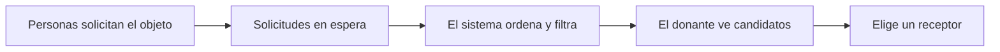

# Ranking de candidatos y sistema de puntos

**Para:** producto, diseño, soporte y stakeholders no técnicos.  
**Versión:** mayo 2026 · Regálalo / Regálalo

Cubre **(1)** la lista que ve el donante para elegir receptor, **(2)** cómo se gana o pierde **reputación**, y **(3)** **límites** para solicitar y recibir objetos.

Si necesitas detalle técnico (APIs, base de datos, consultas de diagnóstico), usa la [guía técnica](./ranking-system.md). Fuente de verdad normativa: [ranking-spec-v1.0.md](./ranking-spec-v1.0.md).

---

## ¿Qué es el ranking?

Cuando alguien publica un objeto y otras personas lo **solicitan**, el **donante** debe decidir a quién se lo regala. El **ranking** es la **lista ordenada** de esas solicitudes en la pantalla **Mis objetos**, sección **Candidatos**.

No es una “nota” que ve el solicitante. Es una **herramienta de decisión para el donante**: quién aparece, en qué orden y con qué datos (nombre, reputación, distancia, fecha de la solicitud).



---

## Sistema de puntos de reputación

El número de **reputación** que aparece junto a cada candidato (y en perfiles) es el **puntaje oficial** de esa persona en la plataforma. **No es lo mismo** que el orden interno de la lista: el ranking **muestra** ese puntaje y **además** aplica reglas de ordenación que no suman ni restan al número visible.

### Punto de partida

| Situación | Puntos iniciales |
|-----------|------------------|
| Usuario nuevo (registro) | **0** |

No hay un mínimo: el puntaje **puede ser negativo** si acumula penalizaciones.

### Cómo se gana o pierde reputación (resumen)

Solo hay **dos tipos de evento** que cambian el puntaje oficial hoy:

| Qué pasó | ¿A quién? | Cambio de puntos | Efecto extra |
|----------|-----------|------------------|--------------|
| **Entrega completada** — el donante confirma que el objeto se entregó | **Donante** (ya donó antes) | **+10** | Se reinicia a **0** la racha de no-shows |
| **Entrega completada** — primera donación histórica del donante | **Donante** | **+15** | Igual que arriba; incentivo de primera donación |
| **Entrega completada** — misma sesión | **Receptor** | **+1** | Se reinicia a **0** la racha de no-shows del receptor |
| **No-show** — el donante indica que el receptor no se presentó / no completó | Solo el **receptor** | Ver tabla siguiente | Sube en 1 la racha de no-shows del receptor |

#### Penalización por no-show (solo receptor)

Cada vez que el donante declara un no-show en una sesión activa, el receptor pierde:

**Puntos perdidos = 10 × (número de no-shows seguidos del receptor después de este incidente)**

| No-show del receptor (seguidos) | Puntos que pierde en ese incidente | Ejemplo si tenía 50 puntos |
|----------------------------------|-------------------------------------|----------------------------|
| 1.º seguido | **-10** | Queda en 40 |
| 2.º seguido | **-20** | Queda en 20 |
| 3.º seguido | **-30** | … |
| Tras una **entrega completada** (+1 receptor / +10 o +15 donante) | La racha vuelve a **0** | El siguiente no-show vuelve a ser **-10** |

**Ejemplo de racha (PRD v1.0):**

```
1.er no-show  → -10
2.º no-show  → -20
Entrega OK    → +1 (receptor) / +10 o +15 (donante); racha a 0
1.er no-show  → -10 otra vez
```

### Qué **no** cambia la reputación oficial

| Situación | ¿Cambia el número de reputación? |
|-----------|----------------------------------|
| Solicitar un objeto | No |
| Aparecer más arriba o abajo en candidatos | No (solo orden) |
| Penalización acaparador Tier 1 en el ranking | **No** (solo baja en la lista) |
| Exclusión acaparador Tier 2 | **No** (deja de verse en candidatos y contador) |
| Quedar oculto como “usuario pasivo” | **No** (solo deja de verse en candidatos) |
| Donante cancela la sesión **sin** marcar no-show | No |
| La sesión **expira** (7 días) sin confirmación de entrega | No — el objeto vuelve a activo **sin** castigo automático |
| Pausar solicitudes en un objeto | No |

### Recuperación de puntos

- **Donante:** completar entregas (**+10** por donación habitual, **+15** en la primera donación histórica).
- **Receptor:** completar entregas como receptor (**+1** por entrega — recuperación lenta).
- **Recuperación significativa:** donar al menos una vez; una sola donación también elimina penalizaciones de acaparador en el ranking.
- **No:** no existe recuperación automática por el paso del tiempo (“esperar y sube solo”).

### Dónde puede verlo el usuario

| Dónde | Qué ve |
|-------|--------|
| Candidatos / perfiles públicos | Puntaje actual (número) |
| **Perfil** (propio) | Historial de movimientos: entrega completada (+10/+15 donante, +1 receptor) o no-show (negativo), con fecha |

El historial es la “extracto bancario” de la reputación; el número grande es el saldo actual.

### Relación con el ranking (recordatorio)

| Concepto | ¿Afecta el número que ves? | ¿Afecta el orden de candidatos? |
|----------|----------------------------|----------------------------------|
| Reputación oficial | Es el número mostrado | Sí, es la base del orden |
| Variación aleatoria ±2 | No | Sí, leve |
| Acaparador Tier 1 (-15 internos) | No | Sí |
| Acaparador Tier 2 (exclusión) | No | Lo saca de la lista y del contador |
| Usuario pasivo | No | Lo saca de la lista |

---

## Límites: solicitar objetos vs recibir objetos

Son dos cosas distintas. Los documentos de ranking a veces hablan de “solicitudes” (pedir un objeto) y de “recibir” (que te elijan y completar la entrega). **No confundirlas.**

### Solicitar (pedir un objeto en el tablón)

| Regla | Valor |
|-------|--------|
| Máximo en la ventana | **3 solicitudes** |
| Ventana de tiempo | **30 días móviles** (siempre los últimos 30 días, no el mes calendario) |
| Qué cuenta | Solicitudes en estado **en espera** o **elegido** (aún no cerradas como descartadas o canceladas) |
| Qué no cuenta | Solicitudes **rechazadas** o **canceladas** (liberan “hueco” para pedir otro) |
| Si intentas una 4.ª | La app bloquea y muestra mensaje de límite alcanzado |
| Un objeto concreto | Solo **una** solicitud por persona y por objeto |

**En la práctica:** un usuario puede tener hasta **3 procesos abiertos** a la vez (esperando respuesta del donante o ya elegido y en entrega), medidos en los últimos 30 días.

### Recibir (quedarte con el objeto)

| Regla | Valor |
|-------|--------|
| Tope de objetos recibidos en la vida | **No hay un máximo fijo** (p. ej. “solo 5 objetos en total”) |
| Cómo se recibe | El donante te **elige** → sesión de entrega → el donante **confirma** la entrega |
| Contador histórico | `total recibidos` sube en **+1** por cada entrega confirmada (dato interno; influye en reglas de pasivo/acaparador) |

**En la práctica:** puedes recibir **tantos objetos como te vayan eligiendo y cerrando en entrega**, siempre que puedas **solicitar** (respetando el tope de 3) y el donante te seleccione.

### Comparación rápida

| Pregunta | Respuesta |
|----------|-----------|
| ¿Cuántos objetos puedo **pedir** a la vez (30 días)? | **Hasta 3** solicitudes abiertas (en espera o ya elegido). |
| ¿Cuántos objetos puedo **recibir** en total? | **Sin tope numérico** en el producto actual; depende de selecciones y entregas completadas. |
| ¿El ranking limita cuánto recibo? | **No.** Solo ordena quién ve el donante entre quienes ya solicitaron. |
| ¿Qué pasa si recibo mucho y dono poco? | Puede afectar **orden** (acaparador Tier 1) o **visibilidad** (Tier 2 si nunca donaste y agotaste cupos repetidamente; pasivo si además estás inactivo). No hay tope de recepciones. |

### Relación con “acaparador” y “pasivo”

- **Acaparador Tier 1:** no impide recibir otro objeto; **baja** la posición en la lista si nunca has donado y agotaste al menos un ciclo de solicitudes.
- **Acaparador Tier 2:** **oculta** al solicitante en listas y contador si nunca donaste y agotaste cupos en al menos **2** ciclos. Donar una vez rehabilita de inmediato.
- **Pasivo:** no borra recepciones pasadas; **oculta** al solicitante en listas de candidatos mientras cumpla la regla de inactividad.

Más detalle de reglas globales: [prd.md](./prd.md) §7 (límites del sistema).

---

## Qué ve el donante (y qué no)

### En la lista de «Mis objetos»

En cada objeto **activo**, puede aparecer un texto del estilo **«3 solicitudes»** o **«Sin solicitudes aún»**. Ese número cuenta solo las solicitudes que **también** aparecerían en el panel de candidatos (misma regla de visibilidad).

### En el detalle del objeto

- Título del objeto, fotos, pausar solicitudes, etc.
- Bloque **«Candidatos (N)»**: la lista ordenada de personas que pidieron el objeto.
- Cada fila suele mostrar: nombre, **reputación**, **distancia** aproximada y antigüedad de la solicitud.

### Lo que el donante **no** ve hoy

| No visible | Por qué importa para producto |
|------------|------------------------------|
| Puntuación “interna” de ordenación | El orden no es solo “reputación en pantalla”; hay reglas extra detrás. |
| Motivo si alguien **no** aparece | Un solicitante puede existir en el sistema pero estar **oculto** por reglas de comunidad (usuario pasivo). |
| Etiqueta “acaparador” | Solo baja en la lista; no hay mensaje explícito en la UI. |

---

## Quién entra en la lista de candidatos

Solo entran solicitudes que cumplen **todo** esto:

1. **El objeto está activo** (aún no se eligió receptor ni se cerró).
2. **La solicitud sigue en espera** (no se ha elegido ya a esa persona ni se descartó al elegir a otra).
3. **El solicitante no está considerado “usuario pasivo”** (ver sección pasivo).
4. **El solicitante no está excluido por acaparador Tier 2** (nunca donó y agotó cupos en ≥2 ciclos de 30 días).

Si alguien solicitó el objeto pero **no** aparece, lo más habitual es la regla del **usuario pasivo** o la **exclusión Tier 2 acaparador**, no un fallo de pantalla.

---

## Usuario pasivo: quién se oculta del ranking

**Objetivo de negocio:** no mostrar al donante perfiles que **solo reciben** y llevan **mucho tiempo sin usar la app**, para priorizar participación equilibrada en la comunidad.

Un solicitante **no aparece** en candidatos (y **no suma** en «N solicitudes») si cumple **las cuatro** condiciones:

| Condición | En lenguaje claro |
|-----------|-------------------|
| Nunca ha donado nada | Ha recibido objetos pero no ha regalado ninguno. |
| Ha recibido al menos un objeto | No es usuario nuevo sin historial de recepción. |
| Tenemos fecha de última actividad | La app registró alguna vez cuándo fue su última acción con sesión iniciada. |
| Lleva más de 60 días sin esa actividad | Considerado inactivo en la plataforma. |

### Casos que suelen generar dudas

| Situación | ¿Aparece en candidatos? |
|-----------|-------------------------|
| Usuario nuevo que solo ha solicitado, nunca recibió | **Sí** |
| Usuario que dona y recibe con normalidad | **Sí** |
| Usuario que recibió objetos pero nunca donó, y **sigue usando la app** (activo en los últimos 60 días) | **Sí** |
| Usuario que recibió, no donó, y **lleva más de 60 días sin entrar** | **No** (pasivo) |
| Usuario que recibió, no donó, pero **nunca registramos última actividad** | **Sí** (no se trata como pasivo) |

**Mensaje para soporte:** si un solicitante insiste en que “sí pidió el objeto” y el donante no lo ve, revisar si encaja en **pasivo** antes de asumir bug.

**Nota:** volver a usar la app (iniciar sesión y actuar) actualiza la “última actividad”; recibir emails o avisos **no** cuenta como actividad para esta regla.

---

## Cómo se ordena la lista (de arriba a abajo)

El donante ve la **reputación oficial** de cada persona. El **orden** de la lista usa esa reputación **más** otros criterios que el donante no ve numerados.

### Prioridad de ordenación

Piensa en una cola con tres desempates, en este orden:

1. **Mejor “puntuación de ordenación” interna** (ver abajo) → más arriba.
2. A igual puntuación interna → **más cerca** del objeto.
3. A igual distancia → quien **solicitó antes**.

### Qué entra en la “puntuación de ordenación” interna

| Factor | Efecto | ¿Lo ve el donante? |
|--------|--------|---------------------|
| Reputación oficial | Base del orden | **Sí** (es el número de reputación en la ficha) |
| Pequeña variación aleatoria (entre -2 y +2) | Puede cambiar ligeramente el orden entre recargas | **No** |
| Penalización “acaparador” Tier 1 (-15 en ordenación) | Baja en la lista si nunca donaste y agotaste al menos 1 ciclo de solicitudes | **No** (la reputación mostrada no baja) |
| Exclusión “acaparador” Tier 2 | No aparece en candidatos ni en contador | **No** |

### Penalización y exclusión “acaparador” (RFC-003)

**Objetivo:** desincentivar quien pide objetos de forma intensiva sin aportar nunca a la comunidad como donante.

**Tier 1 — penalización (sigue visible):**

- Condición: agotaste solicitudes en **al menos 1** ciclo de 30 días **y** nunca completaste una donación.
- Efecto: suele salir **más abajo** en la lista; el número de reputación visible **no cambia**.

**Tier 2 — exclusión (no aparece):**

- Condición: agotaste solicitudes en **al menos 2** ciclos **y** nunca donaste.
- Efecto: **no aparece** en candidatos ni en «N solicitudes».

**Rehabilitación:** completar **una sola donación** elimina Tier 1 y Tier 2 de inmediato.

### ¿Por qué el orden a veces cambia al recargar la página?

Entre dos personas muy parecidas (misma reputación, distancia similar), el sistema aplica una **pequeña variación aleatoria** en cada consulta. Eso puede hacer que intercambien posiciones al actualizar.

- **No es un error de datos** con el comportamiento actual.
- **Sí** es algo a tener en cuenta en pruebas y en copy si prometemos un orden “fijo”.

---

## Los dos números deben coincidir

En **Mis objetos**, para un mismo objeto activo:

| Lugar | Qué muestra |
|-------|-------------|
| Fila de la lista | «N solicitudes» |
| Detalle | «Candidatos (N)» |

**N debe ser el mismo** en ambos sitios: cuentan las mismas solicitudes visibles.

Si en el futuro apareciera «1 solicitud» y «Candidatos (0)», sería señal de **incidencia** (o datos desactualizados), no de regla de negocio. Tras la unificación de reglas (mayo 2026), no debería pasar en condiciones normales.

---

## Qué pasa en otras situaciones del objeto

| Estado del objeto | Candidatos |
|-------------------|------------|
| **Activo**, solicitudes abiertas | Lista visible según reglas anteriores. |
| **Activo**, solicitudes **pausadas** | Las solicitudes ya hechas pueden seguir existiendo; la UI puede desactivar acciones. El donante puede seguir viendo candidatos según diseño de pantalla. |
| **Reservado** (ya hay receptor elegido) | El flujo pasa a entrega; ya no es la lista de “elegir entre todos”. |
| **Completado** o **cancelado** | No aplica elegir candidatos. |

Tras **elegir receptor**, las demás solicitudes dejan de estar “en espera” para ese objeto: desaparecen del ranking de candidatos.

---

## Preguntas frecuentes (producto y soporte)

**¿El ranking decide solo quién gana el objeto?**  
No. Solo **ordena y filtra** quién ve el donante. La decisión final es humana: el donante pulsa elegir receptor.

**¿La distancia excluye a gente lejos?**  
No. La distancia **ordena** (más cerca, más arriba si lo demás es igual), pero no quita a nadie por estar lejos.

**¿Un solicitante puede estar “en el sistema” y el donante ver cero candidatos?**  
Sí, si es **usuario pasivo** o **acaparador Tier 2**: la solicitud existe, pero no se muestra al donante hasta que cambie su perfil de actividad, complete una donación (Tier 2) o deje de ser pasivo.

**¿Por qué dos candidatos con la misma reputación no van siempre en el mismo orden?**  
Por la variación aleatoria pequeña y, en su caso, por distancia o fecha de solicitud.

**¿El donante debería saber que alguien quedó oculto por pasivo?**  
Hoy **no** hay mensaje en producto. Es una posible mejora de transparencia (copy, centro de ayuda o mensaje al solicitante afectado).

**¿Qué revisar si “hay solicitudes” pero la lista va vacía?**  
1. ¿El objeto sigue activo?  
2. ¿Quien mira es el donante del objeto?  
3. ¿El solicitante encaja en **usuario pasivo** o **acaparador Tier 2**?  
4. Si todo lo anterior es “no” y los números no cuadran → escalar a ingeniería con objeto y usuarios implicados.

**¿Cómo sube o baja la reputación de un candidato?**  
Solo con **entrega confirmada** (+10/+15 donante, +1 receptor) o **no-show declarado por el donante** (penalización escalonada -10×n al receptor). Ver sección [Sistema de puntos de reputación](#sistema-de-puntos-de-reputación).

**¿Por qué alguien tiene reputación negativa?**  
Varios no-shows seguidos sin entregas completadas entre medias (p. ej. -10, luego -20…).

**¿Cuántos objetos puede recibir un usuario?**  
No hay un máximo fijo de recepciones. El límite fuerte es **solicitar**: hasta **3** solicitudes abiertas en 30 días. Ver [Límites: solicitar vs recibir](#límites-solicitar-objetos-vs-recibir-objetos).

---

## Resumen en una frase

El ranking es la **lista que el donante usa para elegir receptor**: muestra solicitudes en espera de personas **activas y elegibles**, ordenadas por reputación (con ajustes internos de equidad y aleatoriedad leve), y el contador de la lista debe reflejar **exactamente** cuántas personas aparecen ahí.

---

## Documentos relacionados

| Documento | Contenido |
|-----------|-----------|
| [ranking-system.md](./ranking-system.md) | Guía técnica (APIs, SQL, diagnóstico para dev) |
| [ranking-spec-v1.0.md](./ranking-spec-v1.0.md) | Especificación normativa v1.0 (RFC-001 a RFC-004) |
| [prd.md](./prd.md) §10 | Sistema de reputación (fuente de requisitos) |
| [architecture.md](./architecture.md) §6 | Visión de arquitectura del ranking |
| PRD / épicas | FR17 (pasivo), RFC-003 acaparador (supersede FR18) |
