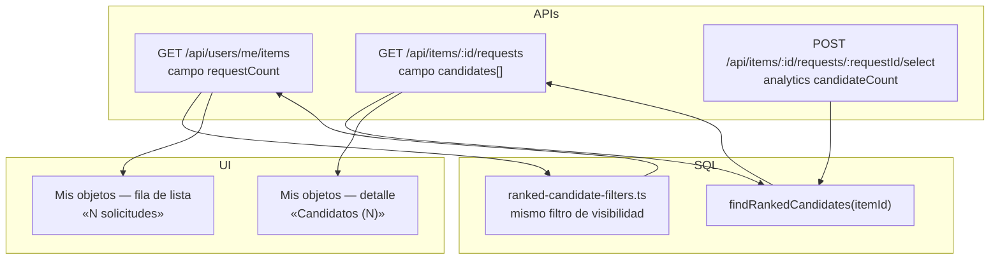
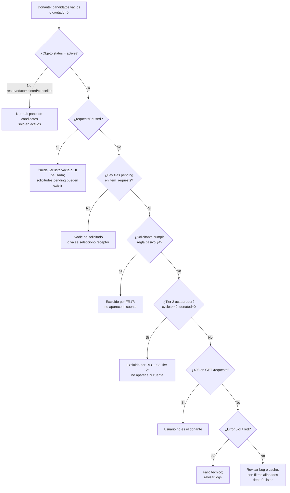

# Sistema de ranking de candidatos

Guía operativa para **ingeniería** y **soporte técnico**. Explica cómo se ordenan las solicitudes (`pending`) de un objeto, qué ve el donante en la app y por qué a veces los números o las listas no coinciden con la intuición.

**Audiencia no técnica (producto, diseño):** [ranking-guia-producto.md](./ranking-guia-producto.md).

**Requisitos de producto relacionados:** FR17 (usuario pasivo), RFC-003 acaparador (supersede FR18 MVP).  
**Fuente de verdad:** [ranking-spec-v1.0.md](./ranking-spec-v1.0.md)  
**Implementación canónica:** `src/infrastructure/database/supabase/request.repository.ts` → `findRankedCandidates`.

---

## Resumen para producto (2 minutos)

| Pregunta | Respuesta corta |
|----------|-----------------|
| ¿Qué es el ranking? | Orden en que el **donante** ve quién pidió su objeto, para elegir receptor. |
| ¿Quién entra en la lista? | Solicitudes en estado `pending` cuyo solicitante **no** está marcado como «pasivo» (FR17) **ni** excluido por acaparador Tier 2 (RFC-003). |
| ¿Qué puntaje ve el donante? | `reputationScore` oficial del solicitante. **No** ve el puntaje interno de ordenación. |
| ¿Por qué «1 solicitud» y 0 candidatos? | Hoy **no debería ocurrir**: el contador de la lista y el panel de candidatos usan el **mismo filtro**. Si ocurre, hay bug o caché/desfase de datos. |
| ¿El orden cambia al recargar? | **Sí**, en parte: hay una aleatoriedad ±2 puntos en cada consulta (ver §3.2). |
| ¿Cómo gana o pierde puntos un usuario? | Solo eventos de reputación oficial (§2); el ranking **no** modifica `reputation_score`. |
| ¿Cuántas recepciones puede hacer? | **Sin tope** de `total_received`; límite de **3 solicitudes** `pending`/`selected` en 30 días (§3). |

---

## Sistema de reputación (`reputation_score`)

El ranking **lee** `users.reputation_score` pero **no lo escribe**. Los cambios ocurren en el flujo de **sesiones de entrega** y quedan auditados en `reputation_events`.

**Fuente de requisitos:** [prd.md](./prd.md) §10 · [ranking-spec-v1.0.md](./ranking-spec-v1.0.md) §7 · **Implementación:** `delivery-session.repository.ts` (`confirmDelivery`, `cancelDelivery`).

### Valor inicial y límites

| Regla | Valor |
|-------|--------|
| Al registrarse | `reputation_score = 0` |
| Mínimo | No hay — puede ser negativo |
| Recálculo desde historial | No — el campo en `users` es la fuente operativa; `reputation_events` es auditoría |

### Eventos que modifican el puntaje oficial

| `reputation_events.type` | Disparador | Usuarios afectados | Delta aplicado | Otros efectos en `users` |
|--------------------------|------------|--------------------|----------------|---------------------------|
| `delivery_completed` | `POST /delivery-sessions/:id/confirm` (donante confirma entrega) | Donante | **+15** si `total_donated_prev = 0`, si no **+10** | `consecutive_no_shows = 0`; `total_donated += 1` |
| `delivery_completed` | Idem | Receptor | **+1** | `consecutive_no_shows = 0`; `total_received += 1` |
| `no_show` | Cancelación de sesión con `noShow = true` (donante declara no-show) | Solo **receptor** | **`-10 × consecutive_no_shows`** tras incrementar el contador | `consecutive_no_shows += 1` en el receptor |

Cada evento `delivery_completed` genera **dos** filas en `reputation_events` con `role` = `'donor'` o `'receiver'` (MIGR-001).

Fórmula no-show (después del `UPDATE` que incrementa la racha):

```
delta = -10 * newConsecutiveNoShows
reputation_score = reputation_score + delta
```

Ejemplos: 1.º no-show seguido → -10; 2.º → -20; 3.º → -30; tras una entrega completada la racha vuelve a 0 y el siguiente no-show vuelve a -10.

### Acciones que **no** cambian `reputation_score`

| Acción | Notas |
|--------|--------|
| Crear solicitud (`POST /items/:id/requests`) | — |
| Cancelar sesión **sin** no-show | Objeto vuelve a `active` |
| Sesión `expired` (deadline 7 días sin confirmar) | Sin penalización automática (PRD) |
| Exclusión usuario pasivo (FR17) | Solo afecta visibilidad en ranking |
| Acaparador Tier 1 -15 (RFC-003) | Solo `effective_score` en SQL de ranking |
| Acaparador Tier 2 (RFC-003) | Exclusión de lista y `requestCount`; no modifica score |
| Perturbación aleatoria ±2 | Solo ordenación |

### API de historial

`GET /users/me/reputation-history` → `{ events: [{ id, type, delta, sessionId, createdAt }] }` con `type ∈ { delivery_completed, no_show }` y `delta` igual al aplicado en su momento.

> **Nota:** la columna `role` existe en BD (MIGR-001); la exposición HTTP del campo `role` es evaluable en historia futura — no forma parte del contrato OpenAPI actual.

### Separación reputación oficial vs ranking

| Mecanismo | ¿Modifica `reputation_score`? | ¿Afecta orden en `findRankedCandidates`? |
|-----------|------------------------------|------------------------------------------|
| Eventos §2 | Sí | Sí (vía valor mostrado) |
| `RANDOM() ±2` | No | Sí |
| Acaparador Tier 1 -15 | No | Sí |
| Acaparador Tier 2 exclusión | No | Excluye fila |
| Filtro pasivo | No | Excluye fila |

---

## Límites de solicitudes y recepciones

**No forma parte del algoritmo de ranking**, pero suele preguntarse junto al flujo de candidatos. Implementación: `PostgresRequestRepository.create` · PRD §7.

### Solicitudes (`POST /items/:id/requests`)

| Regla | Valor |
|-------|--------|
| Máximo | **3** filas en `item_requests` por `requester_id` |
| Ventana | `created_at > NOW() - INTERVAL '720 hours'` (30 días móviles) |
| Estados que consumen cupo | `status IN ('pending', 'selected')` |
| Estados que **no** consumen | `rejected`, `cancelled` |
| Violación | `LimitExceededException` → HTTP 409 (analytics: `limit.reached`) |
| Mismo objeto | Unique `(item_id, requester_id)` — una solicitud por par |

```sql
SELECT COUNT(*) FROM item_requests
WHERE requester_id = $requester
  AND created_at > NOW() - INTERVAL '720 hours'
  AND status IN ('pending', 'selected');
-- si count >= 3 → rechazar nueva solicitud
```

### Recepciones (entregas completadas)

| Regla | Valor |
|-------|--------|
| Tope de `total_received` | **Ninguno** en MVP |
| Incremento | `total_received += 1` en receptor al confirmar entrega (`delivery_completed`) |
| Condición | Haber sido `selected` y que el donante confirme la sesión |

No existe un `max_received` ni un rate limit de “cuántas veces puedes recibir al mes”. El freno práctico es: cupo de solicitudes + selección del donante + cierre de sesión.

### `cycles_at_limit` (relacionado, no es tope de recepción)

Job `pg_cron` incrementa `users.cycles_at_limit` cuando el usuario **agotó las 3 solicitudes** en una ventana de 30 días (como máximo un incremento por ciclo). Se usa para **RFC-003 acaparador** en ranking:

- **Tier 1:** `cycles_at_limit >= 1 AND total_donated = 0` → penalización -15 en `effective_score`.
- **Tier 2:** `cycles_at_limit >= 2 AND total_donated = 0` → exclusión de candidatos y `requestCount`.

No bloquea una nueva recepción directamente; `total_donated >= 1` rehabilita de inmediato ambos tiers.

---

## Dónde se usa el ranking



| Superficie | Endpoint / capa | Qué muestra |
|------------|-----------------|-------------|
| Lista «Mis objetos» | `GET /users/me/items` → `requestCount` | Cuántas solicitudes **visibles en ranking** tiene el objeto activo. |
| Detalle / candidatos | `GET /items/:id/requests` → `candidates` | Lista ordenada de solicitantes elegibles. |
| Selección de receptor | `POST .../select` | Usa la misma query para `candidateCount` en analítica (justo antes de la transacción). |

**Autorización:** solo el **donante** del objeto puede llamar a `GET /items/:id/requests` (403 si no lo es).  
**Rate limit:** 10 peticiones / minuto / IP en ese endpoint.

---

## Pipeline paso a paso

Cada vez que se pide el ranking de un `itemId`, el backend ejecuta esta secuencia lógica:

### Paso 1 — Comprobar objeto y permisos

1. Buscar el objeto y su `donorId`.
2. Si no existe → `404`.
3. Si el usuario autenticado no es el donante → `403`.

*Código:* `GetRankedCandidatesUseCase.execute`.

### Paso 2 — Filtrar solicitudes elegibles

Partir de `item_requests` con:

| Condición | Motivo |
|-----------|--------|
| `ir.item_id = :itemId` | Solo solicitudes de este objeto. |
| `ir.status = 'pending'` | Tras elegir receptor, el resto pasa a `rejected` / la elegida a `selected`; ya no aparecen aquí. |
| Solicitante **no pasivo** (§4) | FR17 — exclusión del ranking. |
| Solicitante **no Tier 2 acaparador** | RFC-003 — exclusión total si `cycles_at_limit >= 2 AND total_donated = 0`. |

### Paso 3 — Calcular datos por candidato

Para cada fila que pasa el filtro:

| Campo en API | Origen | Notas |
|--------------|--------|-------|
| `requestId` | `item_requests.id` | Identificador de la solicitud. |
| `userId` | `requester_id` | Usuario solicitante. |
| `firstName`, `lastName` | `users` | Nombre mostrado en UI. |
| `reputationScore` | `users.reputation_score` | Puntuación **oficial** (la que ve producto/usuario). |
| `distanceMeters` | `ROUND(ST_Distance(item.location, user.location))` | Metros entre objeto y solicitante. Requiere `location` en ambos. |
| `requestDate` | `item_requests.created_at` | Antigüedad de la solicitud. |

**No se expone en la API:** `effective_score` (puntaje interno de ordenación).

### Paso 4 — Calcular puntaje efectivo (solo ordenación)

Fórmula implementada en SQL:

```
effective_score =
  reputation_score
  + perturbación_aleatoria          -- entero entre -2 y +2 (inclusive)
  - penalización_acaparador         -- 0 o 15
```

#### 3.1 Perturbación aleatoria

```sql
FLOOR(RANDOM() * 5 - 2)::int   -- valores: -2, -1, 0, 1, 2
```

**Implicación para producto y QA:** dos refrescos seguidos pueden **reordenar** candidatos con reputación y distancia similares. No es un bug; es comportamiento actual del MVP.

#### 3.2 Control acaparador RFC-003 (Tier 1)

Se restan **15 puntos** al `effective_score` (no modifican `reputation_score` en base de datos) cuando:

```
cycles_at_limit >= 1
AND total_donated = 0
```

El candidato **sigue apareciendo** en la lista; solo baja en el orden. Usuarios en **Tier 2** (`cycles_at_limit >= 2`) quedan excluidos en el `WHERE` y nunca llegan a esta penalización.

### Paso 5 — Ordenar

Criterios, en este orden:

1. `effective_score` **descendente** (mayor primero).
2. `distanceMeters` **ascendente** (más cerca primero).
3. `requestDate` **ascendente** (solicitud más antigua primero).

### Paso 6 — Devolver respuesta

```json
{
  "candidates": [
    {
      "requestId": "uuid",
      "userId": "uuid",
      "firstName": "…",
      "lastName": "…",
      "reputationScore": 10,
      "distanceMeters": 3200,
      "requestDate": "2026-05-29T11:29:37.399Z"
    }
  ]
}
```

---

## Reglas de exclusión: usuario pasivo (FR17)

Un solicitante **no aparece** en `candidates` ni cuenta en `requestCount` si cumple **las cuatro** condiciones:

| # | Campo | Condición |
|---|--------|-----------|
| 1 | `total_donated` | `= 0` (nunca ha donado). |
| 2 | `total_received` | `> 0` (sí ha recibido al menos un objeto). |
| 3 | `last_active_at` | **no es NULL** |
| 4 | `last_active_at` | `< NOW() - 60 days` (sin actividad autenticada en 60 días). |

**Fragmento SQL compartido** (lista + ranking):  
`src/infrastructure/database/sql/ranked-candidate-filters.ts`

### Matriz rápida (producto)

| total_donated | total_received | last_active_at | ¿Visible en ranking? |
|:-------------:|:--------------:|:--------------:|:---------------------:|
| 0 | 0 | cualquiera | Sí |
| >0 | cualquiera | cualquiera | Sí |
| 0 | >0 | NULL | **Sí** (no se considera pasivo) |
| 0 | >0 | hace &lt; 60 días | Sí |
| 0 | >0 | hace ≥ 60 días | **No** (pasivo) |

**Efecto de negocio:** el donante no ve ni cuenta esas solicitudes hasta que el solicitante vuelva a estar activo (actualizar `last_active_at`) o cambie su historial de donaciones/recepciones.

> **Nota:** `last_active_at` solo se actualiza con acciones del usuario autenticado, no por emails ni digest (ver docs de flujo de email).

---

## Reglas de exclusión: acaparador Tier 2 (RFC-003)

Un solicitante **no aparece** en `candidates` ni cuenta en `requestCount` si cumple **ambas** condiciones:

| # | Campo | Condición |
|---|--------|-----------|
| 1 | `cycles_at_limit` | `>= 2` (agotó cupo en al menos 2 ciclos de 30 días) |
| 2 | `total_donated` | `= 0` (nunca ha completado una donación) |

**Rehabilitación:** completar una donación (`total_donated >= 1`) elimina Tier 1 y Tier 2 de inmediato.

### Matriz de interacción FR17 vs Tier 2

| Situación | FR17 (pasivo) | RFC-003 Tier 2 | Resultado |
|-----------|---------------|----------------|-----------|
| `total_donated=0`, `total_received>0`, inactivo >60d, `cycles_at_limit<2` | Sí excluye | No aplica | Excluido (FR17) |
| `cycles_at_limit>=2`, `total_donated=0`, activo | No aplica | Sí excluye | Excluido (Tier 2) |
| Cumple ambas | Sí excluye | Sí excluye | Excluido (redundante) |

Fragmento SQL: `HOARDER_TIER2_EXCLUSION_SQL` y `RANKED_ELIGIBLE_REQUESTER_SQL` en `ranked-candidate-filters.ts`.

---

## Contador `requestCount` en «Mis objetos»

El campo `requestCount` de `GET /users/me/items` **no** es «todas las pending en BD». Es:

```sql
COUNT(*) de item_requests pending
JOIN users
WHERE mismo filtro de visibilidad que findRankedCandidates
```

Por tanto:

- `requestCount` en la fila de la lista **debe coincidir** con `candidates.length` en el detalle (mismo objeto, mismo momento).
- Si en BD hay solicitudes `pending` de usuarios pasivos o Tier 2 acaparador, **no** incrementan el contador ni aparecen en el detalle.

---

## Guía de diagnóstico («¿por qué no ve candidatos?»)



### Checklist para soporte / dev

1. Confirmar **ID del objeto** y que el usuario es el **donante**.
2. `GET /api/items/:id/requests` con token del donante → mirar `candidates.length`.
3. `GET /api/users/me/items` → `requestCount` del mismo `id`.
4. Si `requestCount > 0` pero `candidates` vacío → **incidente** (regresión o despliegue antiguo).
5. Si ambos en 0 pero se espera alguien → consultar BD (§7) o verificar estado `pending` / regla pasivo / Tier 2 acaparador.

---

## Consultas SQL de apoyo (solo entornos autorizados)

Sustituir `:item_id` por el UUID del objeto.

### Todas las solicitudes pending (sin filtro de ranking)

```sql
SELECT ir.id, ir.requester_id, ir.status, ir.created_at
FROM item_requests ir
WHERE ir.item_id = :item_id AND ir.status = 'pending';
```

### Por qué un solicitante queda fuera (pasivo)

```sql
SELECT
  u.id,
  u.total_donated,
  u.total_received,
  u.last_active_at,
  (u.total_donated = 0
   AND u.total_received > 0
   AND u.last_active_at IS NOT NULL
   AND u.last_active_at < NOW() - INTERVAL '60 days') AS is_passive
FROM item_requests ir
JOIN users u ON u.id = ir.requester_id
WHERE ir.item_id = :item_id AND ir.status = 'pending';
```

### Simular quién entraría al ranking (sin aleatoriedad)

```sql
SELECT
  ir.id AS request_id,
  u.reputation_score,
  ROUND(ST_Distance(i.location, u.location))::int AS distance_meters,
  ir.created_at AS request_date,
  (u.cycles_at_limit >= 1 AND u.total_donated = 0) AS hoarder_tier1_penalty,
  (u.cycles_at_limit >= 2 AND u.total_donated = 0) AS hoarder_tier2_excluded
FROM item_requests ir
JOIN users u ON u.id = ir.requester_id
JOIN items i ON i.id = ir.item_id
WHERE ir.item_id = :item_id
  AND ir.status = 'pending'
  AND NOT (
    u.total_donated = 0
    AND u.total_received > 0
    AND u.last_active_at IS NOT NULL
    AND u.last_active_at < NOW() - INTERVAL '60 days'
  )
  AND NOT (
    u.cycles_at_limit >= 2
    AND u.total_donated = 0
  )
ORDER BY u.reputation_score DESC, distance_meters ASC, request_date ASC;
```

> El orden real en producción incluye `RANDOM()` y la penalización -15 en `effective_score`; esta query sirve para depurar **elegibilidad**, no el orden exacto.

---

## Escenarios frecuentes

| Síntoma | Causa probable | Acción |
|---------|----------------|--------|
| Lista «0 solicitudes», detalle vacío | Sin `pending` o todas pasivas | Normal si no hay demanda elegible. |
| Antes: «1 solicitud» y candidatos (0) | Contador contaba todas las `pending`; ranking excluía pasivos o `NULL` mal interpretado | Corregido al unificar filtro + `IS NOT NULL` en pasivo (2026-05). |
| Candidatos cambian de orden al F5 | Perturbación ±2 | Comportamiento esperado; documentar en UX si molesta. |
| Acaparador Tier 1 «mal» en la lista pero abajo | Penalización -15 en orden, no exclusión | Explicar RFC-003 Tier 1. |
| Acaparador Tier 2 no aparece | Exclusión total RFC-003 | Normal; donar rehabilita. |
| `distanceMeters = 0` | Ubicaciones coincidentes o muy cercanas | Revisar geocodificación / CP. |
| Tras seleccionar receptor, lista vacía | `pending` → `selected`/`rejected` | Normal. |

---

## Qué no hace el ranking (límites actuales)

- **No filtra por radio** en `findRankedCandidates`. `ST_Distance` solo **ordena**; no hay filtro `ST_DWithin` en la implementación actual. La [spec §8](./ranking-spec-v1.0.md) incluye `ST_DWithin(u.location, i.location, 50000)` como referencia; el código no excluye candidatos por radio — las solicitudes `pending` ya implican interés en el objeto. Ver [architecture.md §6.3](./architecture.md#63-consulta-sql-de-ranking-en-tiempo-real).
- **No devuelve** `effective_score`, `cycles_at_limit` ni motivo de exclusión en la API (el donante no ve «oculto por pasivo»).
- **No es determinista** entre peticiones por `RANDOM()`.
- **Pausar solicitudes** (`requestsPaused`) afecta la UI y nuevas solicitudes; las `pending` existentes siguen en BD (comportamiento de pausa documentado en historias de ítem).

---

## Referencias en código

| Tema | Archivo |
|------|---------|
| Query de ranking | `src/infrastructure/database/supabase/request.repository.ts` |
| Filtro pasivo compartido | `src/infrastructure/database/sql/ranked-candidate-filters.ts` |
| Constantes Tier 1/Tier 2 | `HOARDER_TIER1_PENALTY_CASE_SQL`, `HOARDER_TIER2_EXCLUSION_SQL`, `RANKED_ELIGIBLE_REQUESTER_SQL` |
| Contador `requestCount` | `src/infrastructure/database/supabase/user.repository.ts` (`findMyItems`) |
| Caso de uso HTTP | `src/application/use-cases/item/get-ranked-candidates.use-case.ts` |
| Reputación (+15/+10/+1 / no-show -10×n) | `src/infrastructure/database/supabase/delivery-session.repository.ts` |
| Historial reputación | `src/application/use-cases/user/get-reputation-history.use-case.ts` |
| OpenAPI `RankedCandidate` | `src/openapi/schemas/item.schemas.ts` |
| Arquitectura (visión general) | `docs/architecture.md` §6.3–6.5 |
| Spec v1.0 (fuente de verdad) | `docs/ranking-spec-v1.0.md` |
| Historia de implementación | `_bmad-output/initiative-backend/tickets/epic-solicitudes-y-ranking-de-candidatos/tickets/story-ver-candidatos-rankeados-para-un-objeto-plan.md` |

---

## Historial del documento

| Fecha | Cambio |
|-------|--------|
| 2026-05-29 | Creación inicial. Alineación `requestCount` ↔ ranking y corrección `last_active_at IS NOT NULL` para usuario pasivo. |
| 2026-05-29 | Sección §2 Sistema de reputación (deltas, eventos, separación vs ranking). |
| 2026-05-29 | Sincronización v1.0 RFC-RANK: deltas asimétricos, no-show -10×n, acaparador Tier 1/Tier 2, `role` en eventos. |
